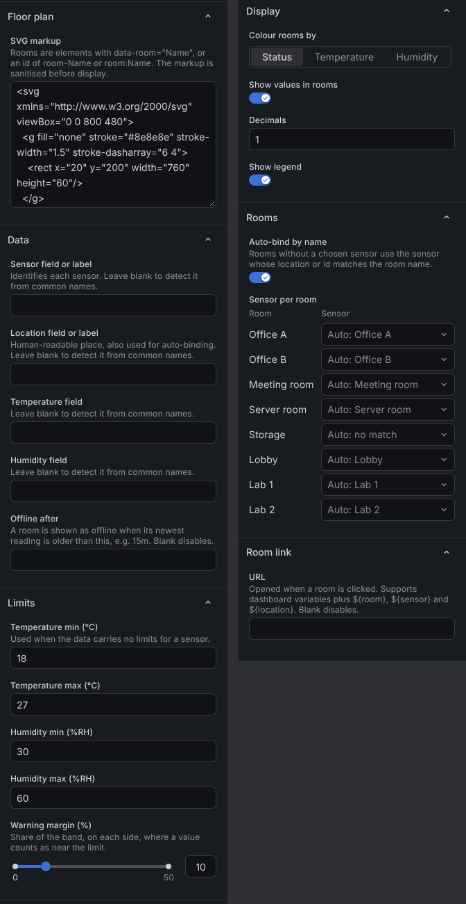

# Climate Floor Map

A Grafana panel plugin that draws a floor plan from SVG and colours each room by its live temperature and humidity, judged against that sensor's own limits.


- **Any floor plan.** Draw it in any vector editor and tag the room shapes. The markup is sanitised before it is shown.
- **Any data source.** It reads plain tables (one row per reading) and per-sensor series (InfluxDB/Flux, Prometheus-style labels). Field names are detected automatically or set by hand.
- **Status at a glance.** Each room is _within limits_, _near a limit_, _out of limits_, _offline_ (no recent reading) or _no sensor_. You can also colour rooms by where the temperature or humidity sits inside its band.
- **Per-sensor limits.** Limits can come with the data (`18-26`, or separate min/max columns). The panel defaults apply when the data has none.
- **Bind sensors to rooms** by name automatically, or pick one per room in the options pane.
- **Hover** for the full reading. **Click** a room to open a URL built from dashboard variables plus `${room}`, `${sensor}` and `${location}`. Rooms are keyboard-focusable when a link is set.

## Floor plan

Any element with a `data-room` attribute, or an id of the form `room-<name>` or `room:<name>`, is a room:

```svg
<svg xmlns="http://www.w3.org/2000/svg" viewBox="0 0 400 200">
  <rect data-room="Lab 1" x="0" y="0" width="200" height="200"/>
  <polygon id="room-Office" points="200,0 400,0 400,200 200,200"/>
</svg>
```

The panel writes the room name and its values at the centre of each shape, so the plan does not need text labels. Scripts, event handlers, `<foreignObject>` and `<use>` are removed. `<title>` elements are dropped so the browser's own tooltip does not cover the panel's tooltip.

The default plan is a small made-up office, so the panel shows something as soon as it is added.

## Data

The panel keeps the newest reading per sensor. It accepts two shapes, and you can mix them across queries.

**Table.** One row per reading, with a string column that names the sensor:

| time             | sensor | location | temperature | humidity | temperature_limits | humidity_limits |
| ---------------- | ------ | -------- | ----------- | -------- | ------------------ | --------------- |
| 2026-01-01 00:00 | n-01   | Office A | 22.4        | 44       | 18-26              | 30-60           |

**Series.** One numeric field per metric, with the sensor in a label (`sensor`, `sensor_id`, `device`, `id` and similar). If there is no such label, the frame name is used. Flux results work as they are: the metric name is taken from the `_field` label.

If you leave the field options blank, the panel recognises these names. Matching ignores case, spaces, `_`, `-` and `.`:

| Meaning           | Names                                                                                                      |
| ----------------- | ---------------------------------------------------------------------------------------------------------- |
| Sensor            | `sensor`, `sensor_id`, `device`, `device_id`, `device_code`, `id`                                          |
| Location          | `location`, `room`, `desc`, `description`, `place`                                                         |
| Temperature       | `temperature`, `temp`, `t`                                                                                 |
| Humidity          | `humidity`, `hum`, `humi`, `rh`                                                                            |
| Limits as text    | `temperature_limits`, `temp_limit`, `humidity_limits`, `hum_limit`, … (`min-max`, `min..max` or `min,max`) |
| Limits as numbers | `temperature_min` / `temperature_max`, `humidity_min` / `humidity_max`, `temp_min`, …                      |

## How a room gets its colour

1. **Find the sensor.** A sensor picked under _Rooms → Sensor per room_ wins. Otherwise, with _Auto-bind by name_ on, the room uses the sensor whose location (or, failing that, id) matches the room name. A sensor bound to another room is never auto-bound.
2. **Offline check.** The room is _offline_ when its newest reading is older than _Offline after_ (default `15m`), counted back from the end of the dashboard time range.
3. **Grade each metric.** A value outside its band is _out of limits_. A value inside the band but within the _warning margin_ of either edge is _near a limit_. The margin defaults to 10 % of the band width on each side. The room takes the worse of its temperature and humidity grades.
4. **Paint.** In _Status_ mode, the grade picks green, orange or red. In _Temperature_ or _Humidity_ mode, the colour runs blue → green → orange across the band, dark blue below it and red above it. Colour changes fade over about a second.

## Options



The screenshot is from the demo dashboard, which clears _Offline after_ because its readings have fixed timestamps.

| Group      | Option                                           | Default     |
| ---------- | ------------------------------------------------ | ----------- |
| Floor plan | SVG markup                                       | demo office |
| Data       | Sensor / location / temperature / humidity field | auto        |
| Data       | Offline after                                    | `15m`       |
| Limits     | Temperature min / max                            | 18 / 27 °C  |
| Limits     | Humidity min / max                               | 30 / 60 %RH |
| Limits     | Warning margin                                   | 10 %        |
| Display    | Colour rooms by                                  | Status      |
| Display    | Show values in rooms, decimals, show legend      | on, 1, on   |
| Rooms      | Auto-bind by name, sensor per room               | on, none    |
| Room link  | URL, open in new tab                             | none, off   |

## Development

Requires Node 22 and Docker.

```bash
npm install
npm run dev          # build and watch
npm run server       # Grafana with the plugin and a demo dashboard at http://localhost:3000
npm run test:ci      # unit tests
npm run lint && npm run typecheck
npm run e2e          # Playwright against the running Grafana
```

The demo dashboard (`provisioning/dashboards/dashboard.json`) uses TestData with fixed readings, so it shows every status without hardware.

Requires Grafana 13.2 or later.

## License

MIT, see [LICENSE](LICENSE).
