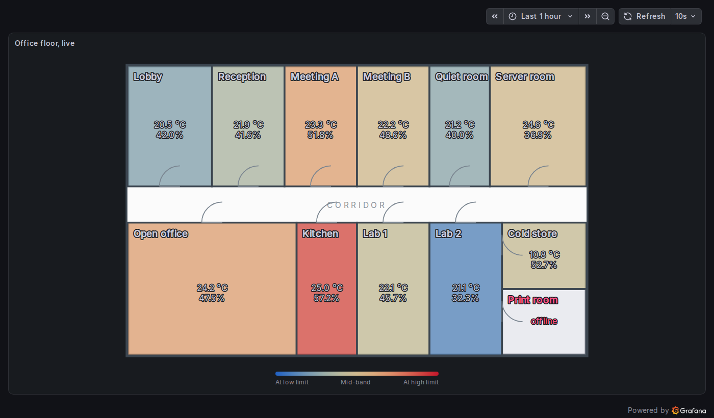
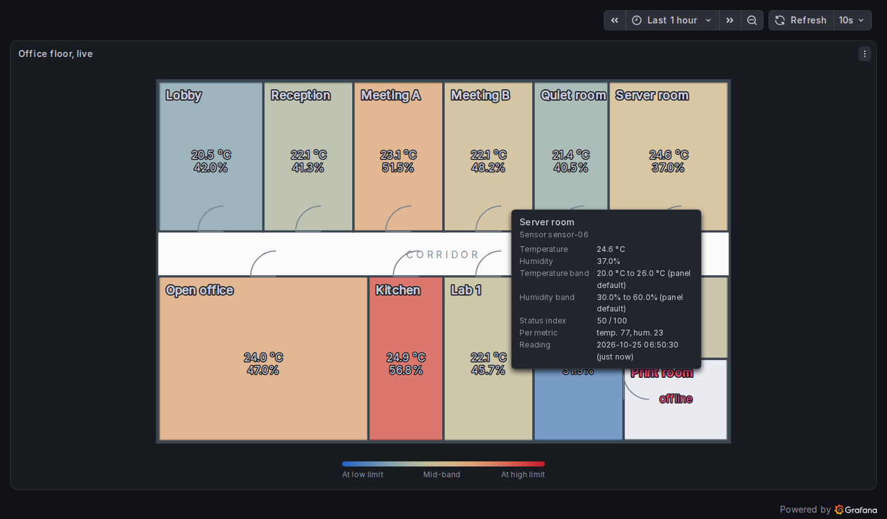

# Climate Floor Map

A Grafana panel plugin that draws your floor plan and colours each room by its live temperature and humidity. One look answers "which rooms are out of range right now?". Hover a room for its readings; click it to open a detail dashboard.



- **No code.** Draw or export the floor as SVG, label the rooms, bind each room to a sensor with a picker.
- **Any data source.** Works with SQL, InfluxDB (Flux), TestData or anything else that returns Grafana data frames, in three layouts (see [Data layouts](#data-layouts)).
- **Grafana-native colours.** Uses the standard colour scheme and threshold options, and follows the light and dark themes.
- **Frontend only.** No backend component, no network calls of its own.

## Quick start with the demo

Requirements: Node.js 22 or later and Docker.

```sh
git clone https://github.com/dkhoa-dev/grafana-climate-floor-map.git
cd grafana-climate-floor-map
npm ci
npm run build
npm run server
```

Open http://localhost:3000. The demo signs you in anonymously as an admin (local development only). The **Climate Floor Map demo** folder holds five dashboards:

| Dashboard    | What it shows                                                                                                                                                                                    |
| ------------ | ------------------------------------------------------------------------------------------------------------------------------------------------------------------------------------------------ |
| Live floor   | A 12-room office that changes every 10 s. The Server room drifts out of range now and then; the Print room sensor never reports, so the room shows as offline. Click a room to open Zone detail. |
| Zone detail  | Temperature and humidity history for the zone and sensor passed in the link.                                                                                                                     |
| Data layouts | The same floor fed by the wide, long and ready-made-index layouts, with both colour modes and both index modes.                                                                                  |
| Edge cases   | One room per state: normal, offline, stale, one metric only, invalid limits, index above 100, unbound, text instead of numbers.                                                                  |
| Large floor  | 36 rooms, to show scale.                                                                                                                                                                         |

All demo data is synthetic. It comes from Grafana's built-in TestData data source and from `scripts/generate-demo.mjs`, which uses a fixed seed. The plans are in `demo/plans/`.

For plugin development, run `npm run dev` (rebuilds on change) next to `npm run server`.



## Draw and mark a floor plan

1. Draw the floor in [Inkscape](https://inkscape.org/) or any vector editor and save it as plain or Inkscape SVG. Keep it vector only: embedded images, `<style>` blocks, scripts and links to other files are removed when the plan is loaded. Use fill and stroke on the shapes themselves (Inkscape does this by default).
2. Mark each room. In Inkscape, select the room's shape, open **Object Properties** (Ctrl+Shift+O) and set **Label** to the room name followed by `[zone]`:

   | Label                  | Meaning                                                                                         |
   | ---------------------- | ----------------------------------------------------------------------------------------------- |
   | `Lab 1 [zone]`         | The shape that gets coloured. Several shapes can share a name; they are coloured together.      |
   | `Lab 1 [zone title]`   | Optional. A text whose colour shows online (theme text colour) or offline (theme error colour). |
   | `Lab 1 [zone readout]` | Optional. A text that the panel replaces with the live values on two lines.                     |

   Room names can contain spaces, dots, brackets and other punctuation. Put the tag on the shape itself (rectangle, path, polygon), not on a group.

3. Writing SVG by hand? Use attributes instead of labels: `data-zone="Lab 1"`, `data-zone-title="Lab 1"`, `data-zone-readout="Lab 1"`.
4. Copy the SVG source into the panel option **Plan drawing > Plan SVG markup**. The **Zone bindings** section then lists every zone it found.

The tag word (`zone`) and the label attribute (`inkscape:label`) are panel options, in case your drawings already use another convention.

## Data layouts

The panel reduces the query result to the newest reading per sensor. Field roles are detected from the field type and name; you can also pick each field in **Data fields**.

| Role             | Names detected (case and `_ - space` ignored)                                              |
| ---------------- | ------------------------------------------------------------------------------------------ |
| Sensor key       | `sensor`, `sensor_id`, `sensor_key`, `device`, `device_id`, `node`, `node_id`              |
| Sensor label     | `label`, `sensor_label`, `sensor_name`, `location`, `room`, `zone`, `display_name`, `name` |
| Temperature      | `temperature`, `temperature_c`, `temperature_f`, `air_temperature`                         |
| Humidity         | `humidity`, `relative_humidity`, `rh`, `humidity_percent`                                  |
| Limits           | `temperature_low`, `temperature_high`, `humidity_low`, `humidity_high`                     |
| Time             | the first time field                                                                       |
| Ready-made index | `status_index`, `index`, `score`                                                           |

**1. Wide: one row per reading.** Typical for SQL. Several rows per sensor are fine; the newest by time wins (the last row when there is no time column). Example for PostgreSQL:

```sql
SELECT DISTINCT ON (sensor_id)
  recorded_at AS time,
  sensor_id   AS sensor,
  room_name   AS label,
  temperature,
  humidity
FROM climate_readings
WHERE $__timeFilter(recorded_at)
ORDER BY sensor_id, recorded_at DESC
```

**2. Long: one series per sensor.** The sensor key and label sit in the series labels; the metric name comes from a `metric` or `_field` column or label. This is what InfluxDB returns for a Flux query grouped by sensor:

```flux
from(bucket: "building")
  |> range(start: v.timeRangeStart, stop: v.timeRangeStop)
  |> filter(fn: (r) => r._measurement == "climate")
  |> filter(fn: (r) => r._field == "temperature" or r._field == "humidity")
  |> group(columns: ["sensor", "location", "_field"])
  |> last()
```

**3. Ready-made index.** A sensor key and a `status_index` from 0 to 100, for pipelines that compute the index themselves. Values outside 0 to 100 are clamped and flagged in the tooltip.

Units come from the field config of the data (for example a temperature override set to °F). Without one, the panel shows °C and %.

## Status index

Each bound room gets a number from 0 to 100, and the colour comes from that number.

- **Position in band** (default). Where the value sits between its low and high limit: 0 at the low limit, 50 mid-band, 100 at the high limit, clamped. The room's index is the mean of temperature and humidity. Both ends mean "out of range", in opposite directions, so a diverging colour scheme suits it (default: blue, yellow, red).
- **Distance outside band.** 0 anywhere inside the band, rising with the distance outside it; one full band width outside is 100. The room takes its worst metric. Use a green to red scheme or thresholds with this mode.

Limits come from the data when a sensor sends a valid pair, otherwise from the **Comfort band** options. The defaults are 20 to 26 °C (EN 16798-1 Category II design range) and 30 to 60 %RH (US EPA advice to stay below 60 %). Invalid limits (low not below high) fall back to the defaults, and the tooltip says so.

**Limitation: averaging.** In position mode a hot, dry room can average out to about 50 and look normal. The tooltip always shows the per-metric positions, and the deviation mode avoids the effect.

## Options

| Section          | Option                                                                                                                          | Default                             |
| ---------------- | ------------------------------------------------------------------------------------------------------------------------------- | ----------------------------------- |
| Plan drawing     | Plan SVG markup, zone tag, label attribute                                                                                      | empty, `zone`, `inkscape:label`     |
| Zone bindings    | One sensor dropdown per zone; **Bind by matching names** binds each unbound zone to the sensor whose label equals the zone name | none                                |
| Data fields      | Field for each role                                                                                                             | detected                            |
| Comfort band     | Temperature and humidity limits; **Offline after (minutes)**                                                                    | 20–26 °C, 30–60 %, 0 (off)          |
| Display          | Status index mode, colouring (continuous or threshold bands), readout decimals, fill opacity, fade                              | position, continuous, 1, 0.8, on    |
| Legend           | Show legend, legend text                                                                                                        | on, defaults per mode               |
| Click-through    | Detail link, open in a new tab                                                                                                  | empty (not clickable), on           |
| Standard options | Colour scheme and thresholds                                                                                                    | blue-yellow-red, steps at 10 and 90 |

The detail link accepts `${__zone.name}`, `${__zone.sensor}` and `${__zone.label}` (URL-encoded), plus dashboard variables such as `${__url_time_range}`. Only `http`, `https` and relative links are opened. Zones with a link are reachable with Tab and open with Enter.

A bound sensor that is missing from the data shows the room as offline. With **Offline after** set, a reading older than that many minutes counts as offline too. The check is off by default so that dashboards looking at a past time range do not show every room as offline.

## Development

| Command                             | What it does                                             |
| ----------------------------------- | -------------------------------------------------------- |
| `npm run dev`                       | Build in watch mode                                      |
| `npm run build`                     | Production build into `dist/`                            |
| `npm run lint`, `npm run typecheck` | ESLint and TypeScript                                    |
| `npm run test:ci`                   | Unit and component tests (Jest)                          |
| `npm run e2e`                       | Playwright tests against a running demo stack            |
| `npm run demo:generate`             | Regenerate demo plans and dashboards                     |
| `node scripts/screenshots.mjs`      | Capture the README screenshots from a running demo stack |

Design decisions and their sources are in [docs/design-log.md](docs/design-log.md).

## License

MIT, see [LICENSE](LICENSE).
