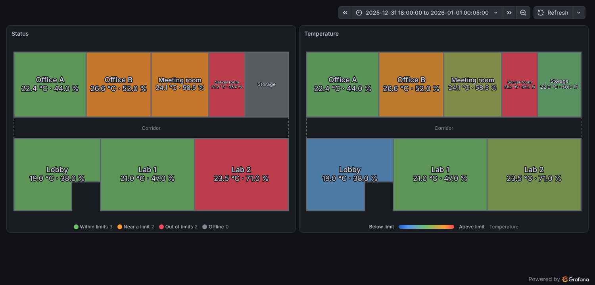
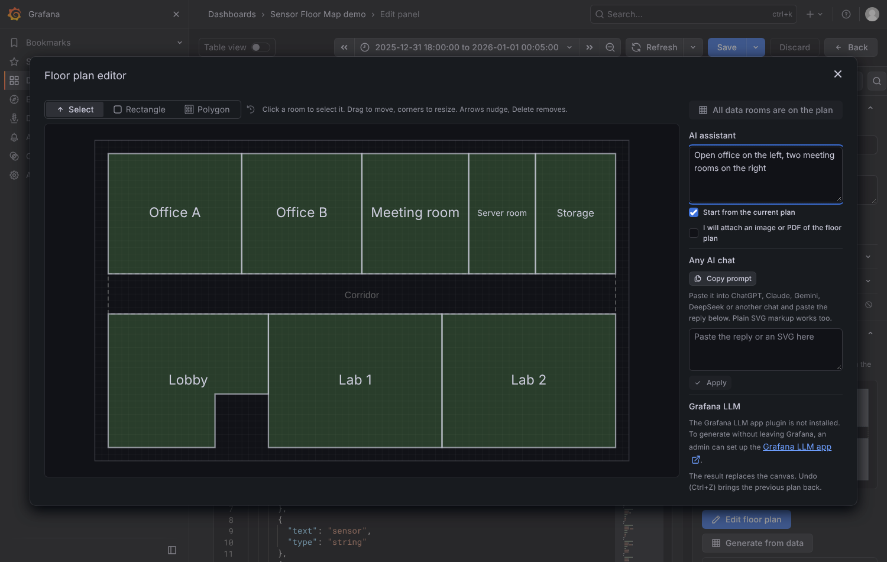
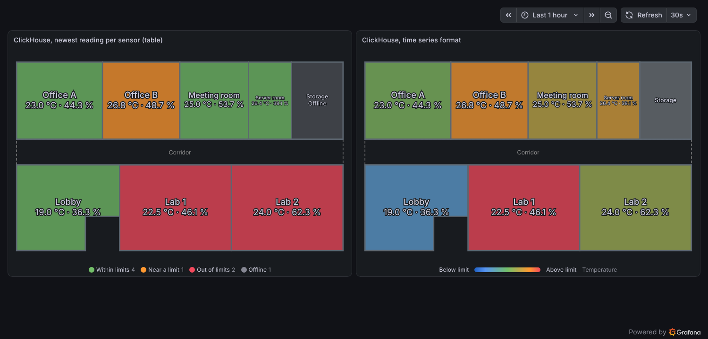

# Sensor Floor Map

A Grafana panel plugin that draws a floor plan from SVG and colours each room by its live sensor readings (temperature, humidity, CO₂ or any other metric), judged against that sensor's own limits.



- **Any floor plan.** Draw it in any vector editor and tag the room shapes. The markup is sanitised before it is shown.
- **Any data source.** It reads plain tables (one row per reading) and per-sensor series (InfluxDB/Flux, Prometheus-style labels). Field names are detected automatically or set by hand.
- **Status at a glance.** Each room is _within limits_, _near a limit_, _out of limits_, _offline_ (no recent reading) or _no sensor_. You can also colour rooms by where the temperature or humidity sits inside its band.
- **Per-sensor limits.** Limits can come with the data (`18-26`, or separate min/max columns). The panel defaults apply when the data has none.
- **Bind sensors to rooms** by name automatically, or pick one per room in the options pane.
- **Hover** for the full reading. **Click** a room to open a URL built from dashboard variables plus `${room}`, `${sensor}` and `${location}`. Rooms are keyboard-focusable when a link is set.

## Floor plan

You do not have to write SVG by hand. Under **Plan drawing** in the panel options:

- **Edit floor plan** opens a drawing editor. Drag to draw rectangles, or click corners to draw a polygon. Move rooms, resize them by their corners, drag polygon vertices, and rename or duplicate rooms. Shapes snap to a grid (hold Alt to place freely). Ctrl+Z undoes, Delete removes, arrows nudge.
- **Generate from data** creates one room for each sensor location in the query result and lays them out as a grid. Rearrange the rooms in the editor to match the building. Because the names match the sensors, they bind automatically.
- **AI assistant** (in the editor sidebar) gets an AI model to draw the plan for you, without any API key or provider set up in the plugin. Describe the floor ("open office on the left, three meeting rooms along the top…"), or tick _I will attach an image or PDF of the floor plan_ to have an existing drawing traced. Leave the description empty and keep _Start from the current plan_ ticked to only fix the format of a pasted SVG. Then:
  - **Any AI chat.** _Copy prompt_ copies the drawing rules and your request. Paste it into ChatGPT, Claude, Gemini, DeepSeek or any other chat, attach the floor plan image or PDF there if you have one, and paste the reply back. The reply may contain other text; plain SVG markup works too. Nothing is sent from Grafana.
  - **Grafana LLM.** If a Grafana admin has set up the [Grafana LLM app](https://grafana.com/grafana/plugins/grafana-llm-app/), _Generate_ sends the request through it with the provider and keys configured there. The app takes text only, so trace drawings through a chat instead.

  The result replaces the canvas, and Ctrl+Z brings the previous plan back.

- **SVG source** still accepts pasted markup.



### SVG format

Any element with a `data-room` attribute, or an id of the form `room-<name>`, is a room:

```svg
<svg xmlns="http://www.w3.org/2000/svg" viewBox="0 0 400 200">
  <rect data-room="Lab 1" x="0" y="0" width="200" height="200"/>
  <polygon id="room-Office" points="200,0 400,0 400,200 200,200"/>
</svg>
```

The panel writes the room name and its values at the centre of each shape, so the plan does not need text labels. Scripts, event handlers, `<foreignObject>`, `<style>`, `<image>`, links and animations are removed, and so is any attribute that would make the browser fetch something: a link to another document, or CSS such as `url(https://…)`, `image-set()` or `@import`. References inside the plan, such as `fill="url(#gradient)"` or `<use href="#shape">`, are kept. `<title>` elements are dropped so the browser's own tooltip does not cover the panel's tooltip.

The default plan is a small made-up office, so the panel shows something as soon as it is added.

## Data

The panel keeps the newest reading per sensor. It is not limited to temperature and humidity: **every numeric field is a metric**, such as CO₂, PM2.5, noise, pressure or occupancy. Use the _Metrics_ option to pick and order them, for example `temperature, humidity, co2`. Leave it blank to use them all.

The data can come in two shapes, and you can mix them across queries.

**Table.** One row per reading, with a string column that names the sensor:

| time             | sensor | location | temperature | humidity | co2 | temperature_limits | co2_max |
| ---------------- | ------ | -------- | ----------- | -------- | --- | ------------------ | ------- |
| 2026-01-01 00:00 | n-01   | Office A | 22.4        | 44       | 640 | 18-26              | 800     |

**Series.** One numeric field per metric, with the sensor in a label (`sensor`, `sensor_id`, `device`, `device_id` or `id`) and, optionally, the location in a `location`, `room` or `place` label. If there is no such label, the frame name is used. Flux results work as they are: the metric name is taken from the `_field` label.

If you leave the sensor and location options blank, the panel recognises these names. Matching ignores case, spaces, `_`, `-` and `.`:

| Meaning  | Names                                              |
| -------- | -------------------------------------------------- |
| Sensor   | `sensor`, `sensor_id`, `device`, `device_id`, `id` |
| Location | `location`, `room`, `description`, `place`         |

### Units, decimals and limits

Each metric takes its unit, decimals and display name from Grafana's **Standard options**, and its limits from **Limits → Limit min / Limit max** in the panel's field config. Set them for one metric with an **override**, for example _Fields with name_ `co2` → _Unit_ `ppm`, _Limit max_ `1000`. Leave one side blank for a one-sided limit. In the time series layout, field names carry the sensor's labels, so match them with _Fields with name matching regex_, such as `co2.*`.

Limits can also come with the data, per sensor, and then take precedence over the field config. Either column (or, in the series layout, label) works:

- `<metric>_limits` (or `<metric>_limit`) as text: `18-26`, `18..26` or `18,26`.
- `<metric>_min` and/or `<metric>_max` as numbers.

When neither the data nor the field config gives a metric any limit, a few well-known metrics fall back to built-in defaults. Each default can be replaced in the field config:

| Metric (field name)    | Unit  | Default limits |
| ---------------------- | ----- | -------------- |
| `temperature` (or `t`) | °C    | 18 – 27        |
| `humidity` (or `rh`)   | %     | 30 – 60        |
| `co2`                  | ppm   | ≤ 1000         |
| `pm2.5` / `pm25`       | µg/m³ | ≤ 25           |
| `pm10`                 | µg/m³ | ≤ 50           |

Any other metric is shown in the room and the tooltip, but has no limits and does not affect the status until you give it some.

### ClickHouse

Works with the official [ClickHouse data source](https://grafana.com/grafana/plugins/grafana-clickhouse-datasource/) in both query formats.

**Table format, newest reading per sensor (recommended).** One row per sensor keeps the query light. A sensor that stopped reporting still has a row, so its room shows as _offline_ instead of dropping off the plan:

```sql
SELECT
  sensor,
  max(time) AS last_seen,
  argMax(location, time) AS location,
  argMax(temperature, time) AS temperature,
  argMax(humidity, time) AS humidity,
  argMax(co2, time) AS co2,
  argMax(temperature_limits, time) AS temperature_limits,
  argMax(humidity_limits, time) AS humidity_limits
FROM readings
WHERE time > now() - INTERVAL 1 DAY
GROUP BY sensor
```

Alias the newest time to anything other than the source column name (`last_seen` here). Otherwise ClickHouse reads `time` inside `argMax` and `WHERE` as `max(time)` and rejects the query.

**Time series format.** The data source turns text columns such as `location` and `temperature_limits` into labels on each value series. The panel reads the sensor, location and limits from those labels. With `$__timeFilter(time)`, a sensor that sent nothing inside the time range is missing from the result. Its room then shows _no sensor_, unless you chose that sensor for the room under **Rooms**, in which case it shows _offline_.



## How a room gets its colour

1. **Find the sensor.** A sensor picked under _Rooms → Sensor per room_ wins. Otherwise, with _Auto-bind by name_ on, the room uses the sensor whose location (or, failing that, id) matches the room name. A sensor bound to another room is never auto-bound.
2. **Offline check.** The room is _offline_ when its newest reading is older than _Offline after_ (default `15m`), counted back from the end of the dashboard time range. A room whose chosen sensor is missing from the query result entirely is offline too.
3. **Grade each metric.** A value outside its limits is _out of limits_. A value inside them but within the _warning margin_ of a limit is _near a limit_. The margin is a share of the band on each side (default 10 %), or of the limit itself when there is only one, so with CO₂ ≤ 1000 ppm, anything above 900 ppm is near the limit. The room takes the worst grade of all its metrics. Metrics without limits are not graded.
4. **Paint.** In _Status_ mode, the grade picks green, orange or red. When colouring by a metric, the colour runs blue → green → orange across its band, dark blue below it and red above it. Colour changes fade over about a second.

## Options

| Group                 | Option                             | Default                         |
| --------------------- | ---------------------------------- | ------------------------------- |
| Plan drawing          | Plan                               | demo office                     |
| Data                  | Sensor / location field or label   | auto                            |
| Data                  | Metrics                            | every numeric field             |
| Data                  | Offline after                      | `15m`                           |
| Limits                | Warning margin                     | 10 %                            |
| Display               | Colour rooms by                    | Status                          |
| Display               | Show values in rooms, show legend  | on, on                          |
| Rooms                 | Auto-bind by name, sensor per room | on, none                        |
| Room link             | URL, open in new tab               | none, off                       |
| Field config          | Unit, decimals, display name       | per well-known metric           |
| Field config → Limits | Limit min / max                    | built-in for well-known metrics |

## Development

Requires Node 22 and Docker.

```bash
npm install
npm run dev          # build and watch
npm run server       # Grafana with the plugin and a demo dashboard at http://localhost:3000
npm run test:ci      # unit tests
npm run lint && npm run typecheck
npm run e2e          # Playwright against the running Grafana
```

Two demo dashboards are provisioned:

- `provisioning/dashboards/dashboard.json` uses TestData with fixed readings, so it shows every status without any database.
- `provisioning/dashboards/clickhouse.json` queries a ClickHouse container that `npm run server` starts alongside Grafana. `dev/clickhouse/init.sql` creates made-up sensors and a view that generates a reading per minute up to `now()`, so the plan stays live; one sensor stops reporting 90 minutes back. It also has a CO₂ column, which the panel picks up with no configuration. Grafana installs the ClickHouse data source on start, which needs access to grafana.com.

Requires Grafana 13.2 or later.

### Releasing

Bump the version with `npm version <patch|minor|major> --no-git-tag-version`, add the release to `CHANGELOG.md` and merge to `main`. The _Tag release_ workflow then tags `v<version>` and runs the _Release_ workflow on it, which builds the plugin and creates a draft GitHub release with the `.zip` and its SHA1. Pushing a `v*` tag by hand works too.

## License

MIT, see [LICENSE](LICENSE).
